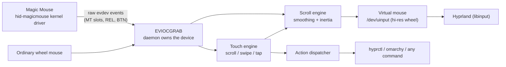

# omarchy-magic-mouse

macOS Magic Mouse behaviour for [Omarchy](https://github.com/basecamp/omarchy)
(Arch + Hyprland): **inertial scrolling**, **smooth wheel scrolling**, and
**swipe gestures** — for an Apple Magic Mouse or an ordinary wheel mouse.

On macOS these behaviours live in the OS: Cocoa adds scroll momentum, and
swipes on the mouse surface drive Mission Control and page navigation. Wayland
compositors see only raw kernel events — libinput has no kinetic scrolling and
Hyprland has no mouse-gesture layer. This daemon fills that gap in userspace.

## Features

- **Inertial scrolling** on the Magic Mouse touch surface: the scroll keeps
  gliding after you lift your finger, with an exponential decay tuned like
  macOS (`scroll.inertia`), stopping instantly on the next touch or click.
- **Smooth wheel scrolling** for ordinary mice: each wheel detent is animated
  into high-resolution scroll instead of jumping one line at a time.
- **Swipe gestures** (two fingers on the Magic Mouse surface): switch
  workspaces, open the app grid or the Omarchy menu; double-tap for a
  smart-zoom style action. Every gesture maps to any command you like.
- **Natural scrolling** by default (content tracks your fingers), per daemon,
  without touching Hyprland's input config.
- **Zero-dependency**: Python 3 standard library only; speaks the kernel's
  evdev/uinput UAPI directly. If it crashes, the kernel drops the device grab
  and your mouse reverts to stock behaviour.

## macOS vs Omarchy: where the behaviour lives

| Concern | macOS | Omarchy (this plugin) |
|---|---|---|
| Scroll momentum | Built into Cocoa scroll views | Synthesized here: velocity estimate on the touch stream, decayed frames injected via `/dev/uinput` |
| Swipe gestures | System-wide, consumed by the OS | Read from the kernel MT stream here; dispatched to Hyprland/Omarchy via `hyprctl` / commands |
| Spaces / Mission Control | Spaces, App Exposé | Hyprland workspaces (`e+1`/`e-1`), app grid (`omarchy-shell omarchy.dock apps`), Omarchy menu |
| Input permissions | TCC "Input Monitoring" prompt | udev rule + `input` group; the daemon grabs the device with `EVIOCGRAB` |
| Scroll direction | "Natural scrolling" per device | `scroll.natural` in the plugin config (default `true`, like macOS) |
| Extensibility | Fixed gestures | Every gesture maps to any command via `gestures.map` / `commands` |

## Gesture defaults

| Gesture (Magic Mouse surface) | Default action | Command run |
|---|---|---|
| Two-finger swipe left | `workspace_next` | `hyprctl dispatch workspace e+1` |
| Two-finger swipe right | `workspace_prev` | `hyprctl dispatch workspace e-1` |
| Two-finger swipe up | `app_grid` | `omarchy-shell omarchy.dock apps` |
| Two-finger swipe down | `omarchy_menu` | `omarchy menu toggle root` |
| One-finger double tap | `smart_zoom` | `hyprctl dispatch sendshortcut CTRL, 0` |
| One-finger tap | `none` | — |

"Swipe left" means fingers move left. In macOS terms: swipes replace page
navigation with workspace navigation, and the app grid/menu stand in for
Mission Control / App Exposé, which Hyprland does not ship.

## How it works



The daemon grabs each managed device, interprets it, and forwards everything
through one virtual mouse — pointer and buttons pass through untouched, while
scroll is re-emitted as paired `REL_WHEEL` + `REL_WHEEL_HI_RES` events (120
hi-res units per detent, per the kernel's event-codes contract). The kernel's
own Magic Mouse wheel emulation is dropped in favour of the touch stream so
one-finger drags can scroll *and* carry momentum. Device classes:

- `apple_touch_mouse` (Magic Mouse 1/2/2 USB-C, or anything exposing MT slots
  alongside pointer + buttons) — full treatment.
- `wheel_mouse` — smooth scrolling.
- `apple_trackpad`, everything else — listed by `omarchy-magic-mouse devices`
  but left to libinput, which already handles them well.

## Install

```bash
git clone https://github.com/YOUR/omarchy-magic-mouse.git
cd omarchy-magic-mouse
./install.sh
```

This installs to `~/.local/share/omarchy-magic-mouse`, symlinks
`~/.local/bin/omarchy-magic-mouse` (Omarchy puts `~/.local/bin` on `PATH`),
writes the default config to `~/.config/omarchy/magic-mouse.json`, and
enables the `omarchy-magic-mouse.service` user unit (modeled on Omarchy's own
session services: `WantedBy=graphical-session.target`,
`ConditionEnvironment=WAYLAND_DISPLAY`).

The system part needs `sudo` once: the udev rule
(`/etc/udev/rules.d/99-omarchy-magic-mouse.rules`) and `uinput` module
loading (`/etc/modules-load.d/`), plus adding you to the `input` group.
**Log out and back in** afterwards so the group applies, then check:

```bash
omarchy-magic-mouse doctor
```

Flags: `--no-system` (skip sudo parts), `--no-enable` (don't start the
service yet). Uninstall with `./uninstall.sh` (add `--purge` to remove the
config and system files).

This is deliberately *not* an Omarchy shell plugin: `~/.config/omarchy/plugins/`
hosts QML running inside `omarchy-shell`, while a device grabber belongs in
its own process. It follows Omarchy's addon conventions instead — user service
under `~/.config/systemd/user/`, config under `~/.config/omarchy/`, CLI on
`~/.local/bin`. (If you want an in-shell gesture HUD later, a `service`-kind
shell plugin can talk to this daemon.)

## Configuration

`omarchy-magic-mouse config` creates the file and opens it in `$EDITOR`;
changes apply on `systemctl --user restart omarchy-magic-mouse`.
`config --show` prints the merged result; unknown keys and bad values are
rejected with a precise error. Defaults shown:

```json
{
  "devices":  { "manage": ["apple_touch_mouse", "wheel_mouse"] },
  "scroll": {
    "natural": true,
    "touch":   { "enabled": true, "detents_per_mm": 1.2 },
    "smooth":  { "enabled": true, "duration_ms": 90 },
    "inertia": { "enabled": true, "tau": 0.35, "min_velocity": 0.3, "max_duration_ms": 1500 }
  },
  "gestures": {
    "enabled": true,
    "fingers": 2,
    "swipe": { "min_distance_mm": 5.0, "axis_ratio": 1.8, "max_duration_ms": 500 },
    "tap":   { "max_duration_ms": 250, "slop_mm": 1.5,
               "double_interval_ms": 350, "double_distance_mm": 5.0 },
    "map": {
      "swipe_left": "workspace_next", "swipe_right": "workspace_prev",
      "swipe_up": "app_grid", "swipe_down": "omarchy_menu",
      "double_tap": "smart_zoom", "tap": "none"
    }
  },
  "commands": {
    "workspace_next": ["hyprctl", "dispatch", "workspace", "e+1"],
    "workspace_prev": ["hyprctl", "dispatch", "workspace", "e-1"],
    "workspace_last": ["hyprctl", "dispatch", "workspace", "previous"],
    "app_grid":       ["omarchy-shell", "omarchy.dock", "apps"],
    "omarchy_menu":   ["omarchy", "menu", "toggle", "root"],
    "browser_back":   ["hyprctl", "dispatch", "sendshortcut", "ALT, Left"],
    "browser_forward":["hyprctl", "dispatch", "sendshortcut", "ALT, Right"],
    "smart_zoom":     ["hyprctl", "dispatch", "sendshortcut", "CTRL, 0"],
    "none": []
  }
}
```

Notable knobs:

- `scroll.inertia.tau` — seconds of momentum time constant (bigger = longer
  glide). `min_velocity` is in detents/second; `max_duration_ms` caps it.
- `scroll.touch.detents_per_mm` — scroll speed of surface drags.
- `scroll.smooth.duration_ms` — how long a wheel detent takes to animate.
- `gestures.fingers` — `2` or `3` fingers for swipes.
- `gestures.map.<gesture>` — a builtin action name, or a custom action:
  `{"command": ["notify-send", "hello"]}`.
- `commands.<action>` — override what any builtin action runs, e.g. map
  swipes to browser history instead of workspaces:

  ```json
  { "gestures": { "map": { "swipe_left": "browser_forward",
                            "swipe_right": "browser_back" } } }
  ```

## CLI

| Command | Purpose |
|---|---|
| `omarchy-magic-mouse run [--dry-run]` | run the daemon in the foreground (the service runs this) |
| `omarchy-magic-mouse status` | service + config state |
| `omarchy-magic-mouse devices` | input devices and how each is treated |
| `omarchy-magic-mouse doctor` | permissions/integration checks |
| `omarchy-magic-mouse config [--init\|--show]` | create/edit/show config |
| `omarchy-magic-mouse start\|stop\|restart` | control the user service |
| `omarchy-magic-mouse log` | follow the service journal |
| `omarchy-magic-mouse simulate [--device …]` | replay a scripted session from stdin |

`simulate` takes `TIME_MS TYPE CODE VALUE` lines (`#` comments) and prints
every output event and action — useful for trying gesture thresholds without
moving your fingers:

```bash
echo '0 EV_ABS ABS_MT_SLOT 0
0 EV_ABS ABS_MT_TRACKING_ID 1
0 EV_ABS ABS_MT_POSITION_X 0
0 EV_ABS ABS_MT_POSITION_Y 0
0 EV_SYN SYN_REPORT 0
16 EV_ABS ABS_MT_POSITION_Y 213
16 EV_SYN SYN_REPORT 0
24 EV_ABS ABS_MT_TRACKING_ID -1
24 EV_SYN SYN_REPORT 0' | omarchy-magic-mouse simulate
```

## Validating on real hardware

The automated suite proves the system paths against a virtual device; the
tactile layer and the install path deserve a pass on a real machine. After
`./install.sh` and a re-login (for the `input` group):

1. `omarchy-magic-mouse doctor` — every required check must be `[ ok ]`.
2. `omarchy-magic-mouse devices` — your mouse must appear as
   `apple_touch_mouse` or `wheel_mouse`, `MANAGED: yes`.
3. `omarchy-magic-mouse log` — one `managing /dev/input/…` line per device.
4. Feel, in order — each is one config knob:
   - flick the Magic Mouse surface and lift: scroll should glide then stop
     (`scroll.inertia.tau`, default 0.35s)
   - drag slowly: 1:1 tracking, no loss at drag start
   - ordinary wheel (if any): detents animate, never jump
     (`scroll.smooth.duration_ms`)
   - two-finger swipes: workspaces switch once per swipe, no false fires
     while scrolling (`gestures.swipe.min_distance_mm`, `axis_ratio`)
   - double tap: app-grid/menu action fires (`gestures.tap.*`)
5. Kill it: `systemctl --user stop omarchy-magic-mouse` — the mouse must
   immediately behave like stock Linux again.
6. Note anything surprising in `omarchy-magic-mouse log` + the config you
   used — that is the useful bug report.

Known watch-item: Hyprland's `sendshortcut` can silently fail on native
Wayland windows in some versions (browser back/forward defaults). If that
happens, override `commands.browser_back`/`browser_forward` with `wtype`.

## Troubleshooting

- **`doctor` fails on /dev/uinput or /dev/input**: finish the system install
  (`./install.sh`) and log out/in so the `input` group applies.
- **Scroll direction flips twice**: `scroll.natural` already flips; if you
  also enabled `natural_scroll` for this device in `~/.config/hypr/input.lua`,
  the two stack. Leave Hyprland's setting off for the "Omarchy Magic Mouse"
  virtual device.
- **Browser back/forward gestures don't fire**: Hyprland's `sendshortcut` can
  misbehave with native Wayland windows in some versions. Override the
  commands with `wtype` if you hit that:
  `{"commands": {"browser_back": ["wtype", "-M", "alt", "-P", "Left", "-m", "alt"]}}`.
- **Feeling is off**: tune with `simulate` + `run --dry-run`; everything
  threshold-like is in the config.
- **Device not managed**: `omarchy-magic-mouse devices` shows the
  classification; only `apple_touch_mouse` and `wheel_mouse` are managed.

## Development

```bash
python3 -m unittest discover -s tests   # 62 tests, no dependencies
test/e2e/run.sh                         # end-to-end suite (see below)
```

The core is deterministic (all timing enters via injected clocks), so the
scroll inertia, gesture recognition, config handling, action dispatch, and the
full event pipeline are tested with synthetic input streams. `magicmouse/evdev.py`
speaks the kernel UAPI directly; its ioctl numbers and struct layout are
pinned by tests against the kernel's stable ABI.

### End-to-end: an emulated Omarchy environment

Unit tests cannot prove system behaviour, so `test/e2e/` runs the daemon
against the **real kernel input core** inside a container with the **real
Omarchy stack** (Arch Linux ARM, the `omarchy` packages from
`pkgs.omarchy.org`, Omarchy's Hyprland build, quickshell): a virtual Magic
Mouse emits events through `uinput` exactly like the `hid-magicmouse` driver,
the daemon grabs and re-emits them, and the assertions read real state —
Hyprland's active workspace, the Omarchy menu surface via `hyprctl layers`,
and libinput's normalized stream. Ten scenarios cover pointer passthrough,
grab-release-on-crash, inertial scrolling, scroll direction, smooth wheel,
swipe→workspace switching, hotplug, the real `omarchy menu` action layer, and
the third-party consumer view.

```bash
sudo modprobe uinput
test/e2e/run.sh        # first run downloads + caches an ALARM rootfs (~830MB)
```

Details, scenario table, and the rig's boundaries: [`test/e2e/README.md`](test/e2e/README.md).
This rig caught four real bugs the unit tests could not: `UI_SET_*BIT` uioctl
argument passing, missing `EV_SYN` forwarding (the kernel buffers events
without a frame marker, so consumers saw nothing), kernel ABS-value coalescing
in the touch engine, and scroll-start slop eating the first millimetres.

Layout: `magicmouse/` (package: `evdev`, `config`, `touch`, `scrolling`,
`actions`, `pipeline`, `sink`, `service`, `cli`), `bin/`, `systemd/`, `udev/`,
`system/`, `tests/`, `test/e2e/`.
