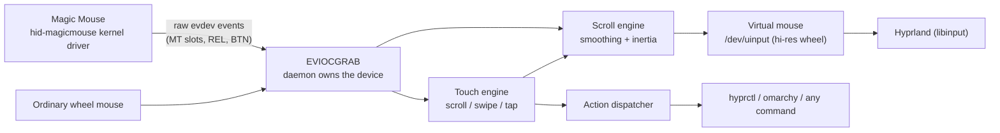

# omarchy-magic-mouse

macOS Magic Mouse behaviour for [Omarchy](https://github.com/basecamp/omarchy)
(Arch + Hyprland): **inertial scrolling**, **smooth wheel scrolling**, and
**swipe gestures** — for an Apple Magic Mouse or an ordinary wheel mouse.

On macOS these behaviours live in the OS: Cocoa adds scroll momentum, and
swipes on the mouse surface drive Mission Control and page navigation. Wayland
compositors see only raw kernel events — libinput has no kinetic scrolling and
Hyprland has no mouse-gesture layer. This daemon fills that gap in userspace.

> **Status**: working and tested (68 unit tests + 10 end-to-end scenarios in
> an emulated Omarchy environment). License: **pending decision by the
> maintainer** — the repository currently has no license file.

## Quick start

```bash
git clone https://github.com/tsonubin/omarchy-magic-mouse
cd omarchy-magic-mouse
./install.sh                    # files + udev rule + input group (asks sudo once)
omarchy-magic-mouse setup       # guided first run: config, permissions, service
omarchy-magic-mouse doctor      # must end with: all required checks passed
```

Then move your mouse: the surface (or wheel) should scroll with macOS-style
glide. `omarchy-magic-mouse log` follows the daemon journal;
`omarchy-magic-mouse setup --dry-run` previews every step without changing
anything.

## Features

- **Inertial scrolling** on the Magic Mouse touch surface: the scroll keeps
  gliding after you lift your finger, with exponential decay tuned like macOS,
  stopping instantly on the next touch or click.
- **Smooth wheel scrolling** for ordinary mice: each wheel detent is animated
  into high-resolution scroll instead of jumping one line at a time.
- **Swipe gestures** (two fingers on the Magic Mouse surface): switch
  workspaces, open the app grid or the Omarchy menu; double-tap for a
  smart-zoom style action. Every gesture maps to any command you like.
- **Natural scrolling** by default (content tracks your fingers), per daemon,
  without touching Hyprland's input config.
- **Zero-dependency**: Python 3 standard library only; speaks the kernel's
  evdev/uinput UAPI directly. If it crashes, the kernel drops the device grab
  and your mouse reverts to stock behaviour.

## Gesture cheat sheet

| Gesture (Magic Mouse surface) | Default action | Command run | Remap key |
|---|---|---|---|
| Two-finger swipe left | `workspace_next` | `hyprctl dispatch workspace e+1` | `gestures.map.swipe_left` |
| Two-finger swipe right | `workspace_prev` | `hyprctl dispatch workspace e-1` | `gestures.map.swipe_right` |
| Two-finger swipe up | `app_grid` | `omarchy-shell omarchy.dock apps` | `gestures.map.swipe_up` |
| Two-finger swipe down | `omarchy_menu` | `omarchy menu toggle root` | `gestures.map.swipe_down` |
| One-finger double tap | `smart_zoom` | `hyprctl dispatch sendshortcut CTRL, 0` | `gestures.map.double_tap` |
| One-finger tap | `none` | — | `gestures.map.tap` |

"Swipe left" means fingers move left. In macOS terms: swipes replace page
navigation with workspace navigation, and the app grid/menu stand in for
Mission Control / App Exposé, which Hyprland does not ship. Builtin actions:
`workspace_next`, `workspace_prev`, `workspace_last`, `app_grid`,
`omarchy_menu`, `browser_back`, `browser_forward`, `smart_zoom`, `none` — or
map a gesture straight to a custom command:

```json
{ "gestures": { "map": { "double_tap": { "command": ["notify-send", "zoom"] } } } }
```

## macOS vs Omarchy: where the behaviour lives

| Concern | macOS | Omarchy (this plugin) |
|---|---|---|
| Scroll momentum | Built into Cocoa scroll views | Synthesized here: velocity estimate on the touch stream, decayed frames injected via `/dev/uinput` |
| Swipe gestures | System-wide, consumed by the OS | Read from the kernel MT stream here; dispatched to Hyprland/Omarchy via `hyprctl` / commands |
| Spaces / Mission Control | Spaces, App Exposé | Hyprland workspaces (`e+1`/`e-1`), app grid (`omarchy-shell omarchy.dock apps`), Omarchy menu |
| Input permissions | TCC "Input Monitoring" prompt | udev rule + `input` group; the daemon grabs the device with `EVIOCGRAB` |
| Scroll direction | "Natural scrolling" per device | `scroll.natural` in the plugin config (default `true`, like macOS) |
| Extensibility | Fixed gestures | Every gesture maps to any command via `gestures.map` / `commands` |

## How it works



The daemon grabs each managed device, interprets it, and forwards everything
through one virtual mouse — pointer and buttons pass through untouched, while
scroll is re-emitted as paired `REL_WHEEL` + `REL_WHEEL_HI_RES` events (120
hi-res units per detent, per the kernel's event-codes contract). The kernel's
own Magic Mouse wheel emulation is dropped in favour of the touch stream so
one-finger drags can scroll *and* carry momentum. Device classes:

- `apple_touch_mouse` (Magic Mouse 1/2/2 USB-C, or anything exposing MT slots
  alongside pointer + buttons) — full treatment.
- `wheel_mouse` — smooth scrolling.
- `apple_trackpad`, everything else — listed by `omarchy-magic-mouse devices`
  but left to libinput, which already handles them well.

### Architecture

| Module | Responsibility |
|---|---|
| `magicmouse/evdev.py` | kernel UAPI (evdev + uinput), no dependencies; virtual-mouse output with paired legacy/hi-res scroll |
| `magicmouse/config.py` | defaults, deep-merge, strict validation (finite numbers, no NaN/Infinity, no NUL in commands) |
| `magicmouse/touch.py` | MT slot tracking → scroll deltas, taps, swipes (mm units via kernel axis resolutions) |
| `magicmouse/scrolling.py` | scroll speed, smooth wheel animation, inertial momentum — deterministic, clocks injected |
| `magicmouse/actions.py` | action specs → commands; failures logged, never raised |
| `magicmouse/pipeline.py` | per-device routing and classification; the only place device semantics live |
| `magicmouse/service.py` | discovery, grabbing, hotplug/rescan, frame loop, clean shutdown |
| `magicmouse/sink.py` / `cli.py` | recording/pretty sink for `simulate`; the `omarchy-magic-mouse` commands |

Invariants worth knowing: the daemon never grabs its own virtual mouse or
any `BUS_VIRTUAL` device (ydotool, input remappers and friends are never
managed); device identity is re-checked on every rescan (event numbers are
recycled); a removed device or a dead sink exits cleanly — the kernel
releases grabs on exit, so the hardware always reverts to stock behaviour;
action commands run off the input path and can never take it down.
Performance characteristics: [docs/PERFORMANCE.md](docs/PERFORMANCE.md).

## Install

```bash
./install.sh
```

Installs to `~/.local/share/omarchy-magic-mouse`, symlinks
`~/.local/bin/omarchy-magic-mouse` (Omarchy puts `~/.local/bin` on `PATH`),
writes the default config to `~/.config/omarchy/magic-mouse.json`, and
enables the `omarchy-magic-mouse.service` user unit (modeled on Omarchy's own
session services: `WantedBy=graphical-session.target`,
`ConditionEnvironment=WAYLAND_DISPLAY`).

The system part needs `sudo` once: the udev rule
(`/etc/udev/rules.d/99-omarchy-magic-mouse.rules`) and `uinput` module
loading (`/etc/modules-load.d/`), plus adding you to the `input` group.
**Log out and back in** afterwards so the group applies.

Flags: `--no-system` (skip sudo parts), `--no-enable` (don't start the
service yet), `--dry-run` (print planned actions, change nothing).
Uninstall with `./uninstall.sh` (add `--purge` to move the config aside to a
timestamped `.bak` — nothing in `~/.config` is ever deleted).

A packaging draft (PKGBUILD + .SRCINFO, **not published** to the AUR) lives
in [`packaging/aur/`](packaging/aur/); it installs the same daemon under
`/usr` instead of `~`. Pick one install method — remove the user-level one
with `./uninstall.sh --purge` first.

This is deliberately *not* an Omarchy shell plugin: `~/.config/omarchy/plugins/`
hosts QML running inside `omarchy-shell`, while a device grabber belongs in
its own process. It follows Omarchy's addon conventions instead — user service
under `~/.config/systemd/user/`, config under `~/.config/omarchy/`, CLI on
`~/.local/bin`. (If you want an in-shell gesture HUD later, a `service`-kind
shell plugin can talk to this daemon.)

## Configuration

`omarchy-magic-mouse config` creates the file and opens it in `$EDITOR`;
changes apply on `systemctl --user restart omarchy-magic-mouse` or a plain
`kill -HUP $(systemctl --user show -p MainPID --value omarchy-magic-mouse)`
(SIGHUP reloads a valid config in place; an invalid one is refused with the
reason and the running config stays).
`config --show` prints the merged result. The file is strict JSON — unknown
keys, wrong types, `NaN`/`Infinity` and NUL bytes are rejected with the exact
path. Every option:

| Key | Type | Default | Meaning |
|---|---|---|---|
| `devices.manage` | list | `["apple_touch_mouse", "wheel_mouse"]` | device classes to grab and drive (`apple_trackpad`/`other` are recognized but cannot be managed) |
| `scroll.natural` | bool | `true` | content tracks fingers (macOS direction); `false` = classic |
| `scroll.touch.enabled` | bool | `true` | surface drags scroll |
| `scroll.touch.detents_per_mm` | number | `1.2` | scroll speed of surface drags (wheel detents per mm of finger travel) |
| `scroll.smooth.enabled` | bool | `true` | animate wheel detents instead of jumping |
| `scroll.smooth.duration_ms` | number | `90` | length of one detent animation |
| `scroll.inertia.enabled` | bool | `true` | momentum glide after a flick |
| `scroll.inertia.tau` | number | `0.35` | seconds; decay time constant (bigger = longer glide) |
| `scroll.inertia.min_velocity` | number | `0.3` | detents/second cutoff where momentum stops |
| `scroll.inertia.max_duration_ms` | number | `1500` | hard cap on momentum length |
| `gestures.enabled` | bool | `true` | swipe/tap recognition on touch surfaces |
| `gestures.fingers` | int (2–3) | `2` | fingers required for swipes |
| `gestures.swipe.min_distance_mm` | number | `5.0` | travel before a swipe fires |
| `gestures.swipe.axis_ratio` | number | `1.8` | major/minor axis ratio; rejects diagonals |
| `gestures.swipe.max_duration_ms` | number | `500` | swipes slower than this are ignored |
| `gestures.tap.max_duration_ms` | number | `250` | max contact time for a tap |
| `gestures.tap.slop_mm` | number | `1.5` | movement still counting as a tap |
| `gestures.tap.double_interval_ms` | number | `350` | max gap between two taps |
| `gestures.tap.double_distance_mm` | number | `5.0` | max distance between two taps |
| `gestures.map.swipe_left` | action / `{"command": [...]}` | `workspace_next` | see the cheat sheet |
| `gestures.map.swipe_right` | action / `{"command": [...]}` | `workspace_prev` | |
| `gestures.map.swipe_up` | action / `{"command": [...]}` | `app_grid` | |
| `gestures.map.swipe_down` | action / `{"command": [...]}` | `omarchy_menu` | |
| `gestures.map.double_tap` | action / `{"command": [...]}` | `smart_zoom` | |
| `gestures.map.tap` | action / `{"command": [...]}` | `none` | |
| `commands.workspace_next` | list of strings | `["hyprctl", "dispatch", "workspace", "e+1"]` | what the action runs |
| `commands.workspace_prev` | list of strings | `["hyprctl", "dispatch", "workspace", "e-1"]` | |
| `commands.workspace_last` | list of strings | `["hyprctl", "dispatch", "workspace", "previous"]` | |
| `commands.app_grid` | list of strings | `["omarchy-shell", "omarchy.dock", "apps"]` | |
| `commands.omarchy_menu` | list of strings | `["omarchy", "menu", "toggle", "root"]` | |
| `commands.browser_back` | list of strings | `["hyprctl", "dispatch", "sendshortcut", "ALT, Left"]` | |
| `commands.browser_forward` | list of strings | `["hyprctl", "dispatch", "sendshortcut", "ALT, Right"]` | |
| `commands.smart_zoom` | list of strings | `["hyprctl", "dispatch", "sendshortcut", "CTRL, 0"]` | resets page zoom (rough smart-zoom analog) |
| `commands.none` | list | `[]` | reserved no-op; must stay empty |

Feel tuning in practice: raise `scroll.inertia.tau` for a longer glide,
`scroll.touch.detents_per_mm` for faster surface scrolling, lower
`gestures.swipe.min_distance_mm` if swipes feel ignored. Try thresholds
without moving your fingers via `omarchy-magic-mouse simulate`.

## CLI

| Command | Purpose |
|---|---|
| `setup [--dry-run]` | guided first run: config, permission fixes, service |
| `doctor` (`diagnose`) | environment checks with a fix for every failure |
| `status` | service, config and device state |
| `devices` | input devices and how each is treated |
| `run [--dry-run]` | run the daemon in the foreground (the service runs this) |
| `config [--init\|--show]` | create/edit/show the merged config |
| `start\|stop\|restart` | control the user service |
| `log` | follow the service journal |
| `simulate [--device …]` | replay a scripted session from stdin |

## FAQ

**Is there a license?** Not yet — the license is an open decision for the
maintainer. The AUR packaging draft carries a placeholder and must not be
published until one is chosen.

**Do I need an Apple Magic Mouse?** No. Ordinary mice get smooth wheel
scrolling; the Magic Mouse additionally gets surface scrolling with inertia
and two-finger gestures.

**Why does it grab my mouse (`EVIOCGRAB`)?** Replacing the kernel's scroll
stream requires owning the device. If the daemon dies or is killed, the
kernel releases the grab and your mouse immediately behaves like stock Linux
again (there is a test that kills it with SIGKILL and checks exactly this).

**Scroll direction flips twice.** `scroll.natural` already flips; if you also
set `natural_scroll` in `~/.config/hypr/input.lua`, the two stack. `doctor`
warns about this combination.

**Will it work with my trackpad?** Apple trackpads are recognized and listed,
but left to libinput, which already handles them well.

**What does it cost?** About 1µs of CPU per input event, zero when idle —
measured in [docs/PERFORMANCE.md](docs/PERFORMANCE.md).

**Why not an Omarchy shell plugin?** Shell plugins are QML inside
`omarchy-shell`; a device grabber belongs in its own process. It still follows
Omarchy's addon conventions (user service, `~/.config/omarchy/` config,
`~/.local/bin` CLI).

**How do I report a bug?** `omarchy-magic-mouse doctor` output,
`omarchy-magic-mouse log`, and the config you used — that is the complete
picture.

## Troubleshooting

Run `omarchy-magic-mouse doctor` first: every failure prints the exact fix.
Common ones:

- **`doctor` fails on /dev/uinput or /dev/input** — finish the system install
  (`./install.sh`) and log out/in so the `input` group applies.
- **The daemon is running but gestures do nothing** — `omarchy-magic-mouse
  devices` must show your device as `MANAGED: yes`; only
  `apple_touch_mouse` and `wheel_mouse` classes are managed.
- **Browser back/forward gestures don't fire** — Hyprland's `sendshortcut`
  can misbehave with native Wayland windows in some versions. Override with
  `wtype`:
  `{"commands": {"browser_back": ["wtype", "-M", "alt", "-P", "Left", "-m", "alt"]}}`.
- **Feeling is off** — tune the three knobs in the config table above;
  `simulate` shows what any threshold would do.
- **After a crash or update the mouse feels "stock"** — expected: grabs are
  released when the daemon exits. `systemctl --user restart
  omarchy-magic-mouse` brings the behaviour back.

## Validating on real hardware

The automated suite proves the system paths against a virtual device; the
tactile layer and the install path deserve a pass on a real machine. After
`./install.sh` and a re-login (for the `input` group):

1. `omarchy-magic-mouse doctor` — every required check must be `[ ok ]`.
2. `omarchy-magic-mouse devices` — your mouse must appear as
   `apple_touch_mouse` or `wheel_mouse`, `MANAGED: yes`.
3. `omarchy-magic-mouse log` — one `managing /dev/input/…` line per device.
4. Feel, in order — each is one config knob:
   - flick the Magic Mouse surface and lift: scroll should glide then stop
     (`scroll.inertia.tau`, default 0.35s)
   - drag slowly: 1:1 tracking, no loss at drag start
   - ordinary wheel (if any): detents animate, never jump
     (`scroll.smooth.duration_ms`)
   - two-finger swipes: workspaces switch once per swipe, no false fires
     while scrolling (`gestures.swipe.min_distance_mm`, `axis_ratio`)
   - double tap: app-grid/menu action fires (`gestures.tap.*`)
5. Kill it: `systemctl --user stop omarchy-magic-mouse` — the mouse must
   immediately behave like stock Linux again.
6. Note anything surprising in `omarchy-magic-mouse doctor` output +
   `omarchy-magic-mouse log` + the config you used — that is the useful bug
   report.

## Development

See [CONTRIBUTING.md](CONTRIBUTING.md) for the workflow. In short:

```bash
python3 -m unittest discover -s tests   # unit suite, no dependencies
python3 -m unittest tests.test_scroll   # targeted run for one area
test/e2e/run.sh                         # end-to-end suite (emulated Omarchy)
test/e2e/run.sh bench                   # performance benchmark
```

Layout: `magicmouse/` (package: `evdev`, `config`, `touch`, `scrolling`,
`actions`, `pipeline`, `sink`, `service`, `cli`), `bin/`, `systemd/`, `udev/`,
`system/`, `tests/`, `test/e2e/` (rig + bench), `packaging/aur/` (draft),
`docs/` (plans, performance).
