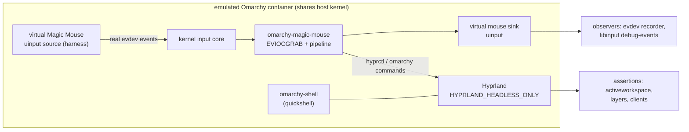

# End-to-end test rig: an emulated Omarchy environment

Unit tests prove the engine logic. This rig proves the *system* behaviour:
the daemon runs against the **real kernel input core** (uinput + evdev), inside
a container running the **real Omarchy desktop stack** (Arch Linux ARM, the
`omarchy` packages from `pkgs.omarchy.org`, Hyprland, quickshell), and the
assertions read **real observable state** — the evdev stream a consumer sees,
Hyprland's active workspace, the compositor's surface list, libinput's
normalized output.

## How the rig works

The container shares the host kernel, so `/dev/uinput` and evdev are not
faked: the harness manufactures a Magic Mouse exactly the way the
`hid-magicmouse` kernel driver does (same uinput ABI, same MT slot geometry,
same axis resolutions), and the daemon reads it through `/dev/input`.



Isolation: the rig mknods only the device nodes it owns into a private
`/dev/input` (the virtual source and the daemon's sink), so the daemon can
never grab a host's real devices, and hotplug scenarios stay deterministic.
It also writes the udev database entries for those nodes (`/run/udev/data`)
— the metadata a real system's udev provides — so libinput accepts them.

## Scenarios

| Scenario | Proves | Assertion source |
|---|---|---|
| `pointer_passthrough` | pointer/buttons survive interception | sink evdev stream |
| `crash_safety_grab_release` | SIGKILL releases the grab; hardware never dies | source evdev stream before/after kill |
| `touch_scroll_natural` | surface drag scrolls, natural (macOS) direction | exact hi-res + legacy detents on sink |
| `natural_sign_flips` | `scroll.natural=false` inverts direction | sink evdev stream |
| `inertial_scrolling` | momentum continues after lift, decays, stops on its own | post-lift frame series on sink |
| `wheel_smoothing` | detents animate into hi-res scroll, exact total | sink evdev stream |
| `swipe_switches_workspace` | two-finger swipe switches workspaces | `hyprctl activeworkspace` |
| `hotplug_attach` | devices plugged in later are managed | daemon log + sink stream |
| `omarchy_menu_gesture` | swipe runs real `omarchy menu toggle root` and the menu surface appears | `hyprctl layers`/`clients` |
| `libinput_sees_coherent_scroll` | a third-party consumer reads a clean stream | `libinput debug-events` |

## Running it

```bash
sudo modprobe uinput        # host kernel module for virtual devices
test/e2e/run.sh             # builds the image on first run (~830MB rootfs, cached)
```

The first run downloads the official ArchLinuxARM rootfs (cached in
`/tmp/mm-e2e-cache`), imports it as `mm-e2e-base`, builds `mm-e2e` with the
real Omarchy packages, then runs unit tests + all scenarios in a throwaway
container. Code under test is bind-mounted from the checkout, so code edits
need no rebuild.

Host requirements: docker, `/dev/uinput`, and a DRM node for the compositor
(`run.sh` uses the host GPU's `/dev/dri`, falling back to `modprobe vkms` on
bare CI runners — aquamarine's allocator needs one real DRM node even for
headless rendering). No privileged mode, no KVM.

## Boundaries (what this rig does not claim)

- The `hid-magicmouse` kernel module itself is not under test — the rig speaks
  the same evdev protocol that module produces (MT slots + REL + BTN, verified
  against the driver's geometry), from userspace.
- The shell's rendering is not asserted, only its compositor-visible surfaces
  and the commands that reach it.
- Real Bluetooth pairing/hotplug of physical hardware is out of scope.

CI runs the same `run.sh` on a native arm64 runner
(`.github/workflows/ci.yml`).
